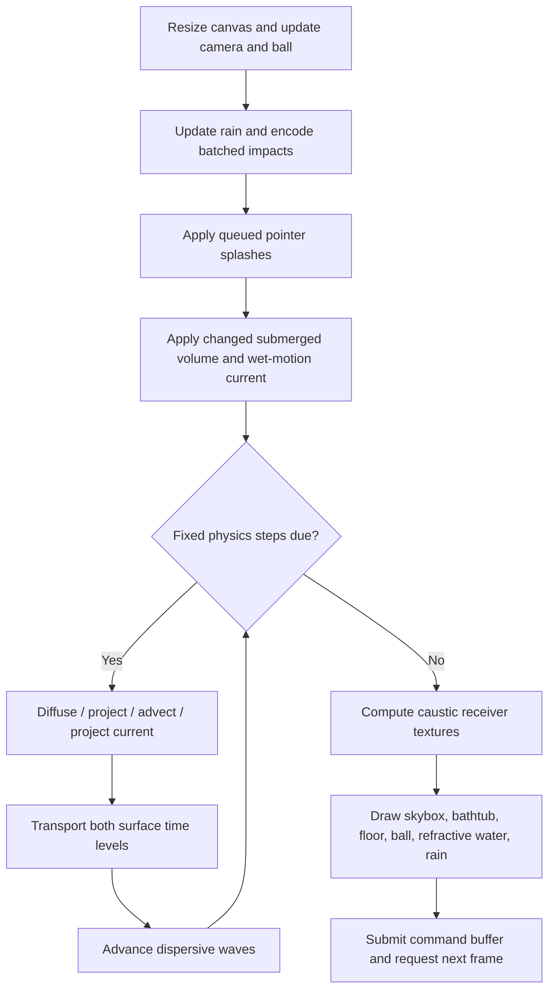

# How Water WebGPU works

Water WebGPU draws an interactive pool using two coupled simulations: a **2D horizontal current field** and a **dispersive surface-height field**. Currents can carry the surface, but waves do not push back on currents. This is a browser graphics and numerical-methods project, not a full 3D liquid solver or in any way validated CFD model.

## 1. The fields and their coordinates

The water spans **290 × 590 world units** in the X–Z plane, centred at the origin. Y is vertical; the rest waterline is Y = 80. Surface heights are displacements from that level, not absolute world Y. These are application units, not calibrated metres.

| Field | GPU representation | Grid at the default High setting | Owner |
|---|---|---|---|
| Horizontal current | `vec2f(u_x, u_z)` per cell; velocity is in world units per simulation second | 50 × 100 cell centres | [`StableFlow`](../src/water/flow.ts#L53-L85) |
| Surface displacement | `vec2f(h_previous, h_current)` per vertex, in two alternating storage buffers | 149 × 301 vertices | [`WaterCompute`](../src/water/compute.ts) |

[`makeGrid`](../src/types.ts#L15-L44) derives surface dimensions and X/Z spacings from the selected number of rows. [`StableFlow.constructor`](../src/water/flow.ts#L74-L85) caps the current grid at 100 rows, keeping pressure solves smaller than the surface mesh. Increasing water resolution therefore does not necessarily increase current resolution; Ultra Low is below that cap.

The current starts at zero. Water clicks and rain do not inject horizontal velocity, but moving a wet ball does, through [`StableFlow.addImpulse`](../src/water/flow.ts). The Flow Viscosity slider affects those ball-driven currents, not the strength of ordinary click ripples.

## 2. Startup and one frame

[`main`](../src/main.ts#L22-L59) owns the objects and connects their resources:

- [`initWebGPU`](../src/wgpu/context.ts) obtains an adapter/device, configures the canvas, and owns its resizable depth texture. There is no WebGL fallback; device loss is logged, not automatically recovered.
- [`OrbitCamera`](../src/camera/orbit.ts) owns view/projection matrices and right-drag/scroll controls.
- `WaterCompute`, `WaterRender`, and `Caustics` share the water-grid description. Rendering and caustics read the simulation's current GPU buffer directly.
- `Bathtub`, `Floor`, `Skybox`, `Rain`, and `DragSphere` provide the rest of the scene. The bathtub and refracted pool share the same material bind group, including tile and caustic textures; the ball shares its shading function with water. No screen-space scene capture is needed.

The actual command order is in [`frame`](../src/main.ts):



The CPU handles events, the camera, ball and rain-particle positions, uniforms, and command encoding. The large fluid fields remain on the GPU; the animation loop does not read them back to JavaScript. Rain, pointer impacts, and sphere-volume changes are applied once per displayed frame, before any due physics steps. An unpaused frame with no physics step can still apply a click or ball displacement and render it.

**Why alternating buffers?** Stencil kernels need neighbours from the old field. Writing those same neighbour values during a dispatch would introduce execution-order-dependent results across workgroups. Jacobi iterations, advection, and wave evolution instead read one buffer and write another. Each surface substep transports into the other buffer, swaps, advances waves into the other buffer, and swaps again. Consumers use [`currentStateBuffer`](../src/water/compute.ts#L228-L234), rather than assuming which buffer is current.

## 3. Horizontal flow: what each solver stage does

[`StableFlow.step`](../src/water/flow.ts#L198-L204) implements the Stable Fluids splitting described in Jos Stam's *Real-Time Fluid Dynamics for Games*. The intended horizontal model is incompressible Navier–Stokes: momentum is transported, diffused by viscosity, and corrected by pressure.

1. **Diffuse velocity.** Backward Euler gives `(I − ν Δt L) u_new = u_input`. The [`diffuse` kernel](../src/water/flow.ts#L30-L34) performs 20 Jacobi iterations, alternating scratch buffers while retaining the original velocity as the fixed right-hand side. Viscosity is a supplied coefficient, not an unknown being solved for.
2. **Project velocity.** The [`divergence`, `pressure`, and `project` kernels](../src/water/flow.ts#L35-L46) calculate `d = D u`, approximately solve `L φ = d` with 60 Jacobi iterations, then subtract `G φ` from velocity. Here `φ` is a scaled pressure-correction potential, not pressure in pascals. Each [`project`](../src/water/flow.ts#L223-L227) call starts the potential at zero and keeps divergence fixed during the iterations.
3. **Advect velocity by itself.** The [`advect` kernel](../src/water/flow.ts#L47-L48) backtraces from each destination to `x − Δt u(x)`, then bilinearly samples the old velocity field. This semi-Lagrangian method is robust for interactive transport, but introduces numerical diffusion.
4. **Project again.** Interpolation can introduce divergence, so a second complete projection corrects the advected field.

Jacobi iterations refine a linear-system solution within one timestep; they are not additional physical timesteps. The solver has fixed iteration counts, not a residual-based stopping condition.

[`velocity` and `pressure`](../src/water/flow.ts#L12-L28) implement implicit boundary samples: reflect the normal velocity component and copy tangential velocity and pressure. These are impermeable **free-slip** walls, not no-slip walls with resolved boundary layers.

Projection reduces divergence but does not guarantee exact incompressibility. Besides finite iteration error, the centred divergence and gradient on this collocated grid do not compose to the five-point pressure Laplacian (`DG ≠ L`). More Jacobi iterations alone cannot fix that operator mismatch.

## 4. Surface transport and waves

Before advancing waves, the [`surfaceCode` shader and `advectSurface`](../src/water/flow.ts) sample current velocity at each surface vertex and bilinearly backtrace **both stored heights together**. Transporting only the current height would change the pair's difference and create an artificial vertical-velocity contribution. This is one-way coupling and is not a globally volume-conservative transport scheme.

The wave [`COMPUTE_SHADER`](../src/water/compute.ts#L14-L73) then advances

$$
 h_{tt} + \gamma h_t = c^2\left(Lh - \ell^2 L^2h\right),
 \qquad \ell = 3\text{ world units}.
$$

`L` is the rectangular-grid finite-difference Laplacian; applying it twice gives the biharmonic term `L²`. That term makes the model dispersive: shorter wavelengths propagate faster. This is a **capillary-style height-field equation**, not the full shallow-water equations or the full finite-depth gravity–capillary dispersion relation.

The shader computes acceleration from the current height and uses a centred damped Verlet-style update. Its destination pair is `(h_current, h_next)`. The increment form at [`nextY`](../src/water/compute.ts#L64-L71) reduces floating-point cancellation when heights have a nonzero offset.

[`height`](../src/water/compute.ts#L30-L43) mirrors samples at walls, including those needed by the biharmonic stencil. This imposes zero normal slope: waves reflect, and boundary heights are allowed to move. The boundary is not pinned to zero. Water normals and caustic gradients use the same reflection convention.

### The clock is separate from wave speed

[`WaterCompute.constructor`](../src/water/compute.ts#L161-L173) chooses a fixed timestep for each resolution from a dispersive CFL bound, evaluated at the supported maximum wave-speed multiplier of 2. The timestep is additionally capped at `1000 / 120 * SIM_SPEED` milliseconds. Finer grids require smaller stable steps.

[`simulate`](../src/water/compute.ts#L276-L335) accumulates elapsed time, runs all due fixed steps, and retains the fractional remainder. It caps each wall-time frame at 100 ms before scaling, so a suspended tab does not catch up indefinitely.

- **Simulation Speed** scales the accumulator and rain motion. It changes how many steps run, not their duration. The app starts at 0.5×; zero freezes simulation and ignores water clicks while keeping the camera and ball movable. On resume, the ball applies the net displacement since its last accepted pose.
- **Wave Speed** changes `c²`, hence propagation physics. The implementation clamps its multiplier to 0–2; the UI starts at 1.
- **Damping** maps to `γ = 0.05 × damping²`, controlling vertical-wave decay. It is separate from current viscosity.
- **Units matter:** the wave solver uses milliseconds, with `C = 0.05` world units/ms and the additional elapsed-time factor `SIM_SPEED = 1.3` from [`types.ts`](../src/types.ts#L46-L54). Flow receives the same step divided by 1000, in seconds. Rain uses its own 50 ms frame cap and the user speed multiplier, not the additional `SIM_SPEED` factor.

Fixed steps support repeatable equal-time comparisons with controlled forcing. They do not make random rain or frame-batched user events identical at arbitrary rendering rates.

## 5. Pointer input and rain redistribute surface water

[`setupInteraction`](../src/water/interaction.ts) unprojects the pointer with the inverse view–projection matrix. A left press first raycasts the ball; a hit starts a ball drag instead of a splash. Otherwise, it intersects the **flat rest-water plane**, not the displaced mesh, and discards hits outside the pool.

A left press on the water deposits a full click. Dragging interpolates smaller deposits along the world-space path: 1/12 click strength at 1/12 of the nominal spacing. With the default ripple size, the spacing is 2.5 world units. Carrying the remaining distance between events avoids tying trail density to mouse-event frequency. Holding still deposits nothing; leaving the pool breaks the segment. The [`main.ts` callback](../src/main.ts#L224-L228) batches hits and rejects them while paused.

The [`click shader`](../src/water/compute.ts#L75-L124) and rain's [`IMPACT_SHADER`](../src/scene/rain.ts#L29-L56) share [`CONSERVATIVE_SPLASH_WGSL`](../src/water/splash.ts):

- A reflected Gaussian potential is sampled with the same mirrored discrete Laplacian used at boundaries.
- Pointer splashes use its negative sign: a raised centre and compensating trough. Rain uses the opposite sign: a depression and compensating rim.
- The area-weighted displacement sums to zero up to floating-point error. Edge vertices have half-cell weights; corners have quarter-cell weights. A plain unweighted vertex average is not the correct volume measure.
- Both previous and current heights receive the same displacement, preserving their difference rather than injecting a timestep-dependent vertical kick. There is no global recentering, height clamp, or periodic level reset.

[`Rain.update`](../src/scene/rain.ts#L116-L177) maintains 96 falling drops on the CPU, detects crossing of the nominal waterline, and batches that frame's impacts into one compute dispatch. [`Rain.render`](../src/scene/rain.ts#L179-L184) draws instanced line streaks. Variety changes per-spawn size and speed samples; strength zero keeps the streaks without disturbing the water. Disabling rain hides the streaks and stops impacts, but does not erase existing waves.

For the app's actual defaults, read [`index.html`](../index.html#L314-L350) together with the [`main.ts` initialization](../src/main.ts#L85-L111): rain strength is 2, size 8, and variety 0.5. The `Rain` class's standalone strength initializer is 14, but the app overwrites it from the UI.

### Ball displacement

Ordinary ball dragging uses a camera-facing plane fixed at the grabbed point, allowing vertical motion without snapping the ball's centre to the cursor. Holding Shift when grabbing selects a horizontal plane at the current depth. [`DragSphere`](../src/scene/sphere.ts) follows the target in three dimensions and clamps against the walls and floor. Its radius is 32, so it fits completely below the rest waterline at 80. Release holds the chosen position; there is no autonomous buoyancy or gravity simulation.

[`WaterCompute`](../src/water/compute.ts) retains the previous accepted sphere pose. It applies the submerged column near the ball at 15% strength. The remaining 85% of the analytic submerged volume contributes to a small uniform water-level change, preserving displacement without creating diameter-sized local crests:

```text
h = clamp(WATER_LEVEL − center_y + radius, 0, 2 * radius)
volume = pi * h² * (radius − h / 3)
column = cell_average(submerged_sphere_column)
source = 0.15 * column + 0.85 * volume / (pool_width * pool_length)
displacement = source(new_pose) − source(previous_pose)
```

Four quarter-cell samples average the submerged column to soften grid aliasing at the sphere's rim, without spreading it into a broad mound. The wave-producing source remains localized around the ball. This reduces the forcing strength, not existing waves: it does not clip surface heights or increase wave damping.

The displacement is added to **both** stored surface heights. Insertion raises water, extraction lowers it, and horizontal movement removes displaced water behind the ball while adding it ahead. A stationary pose applies nothing: existing waves continue propagating rather than being relaxed toward a target bulge. Disabling or omitting the ball removes its displaced volume once. Resetting the water also clears the accepted-pose history.

Wet horizontal motion additionally injects a current impulse proportional to horizontal displacement and the spherical-cap submerged-volume fraction. Airborne or disabled movement does not stir the current. Submergence uses the rest waterline, not the instantaneous waves; this remains a height-field approximation, not a 3D solid-fluid collision solver. Grid sampling approximates the inserted volume, and the existing surface-advection step is not globally volume-conservative.

Sphere regressions in [`tests/water-physics.html`](../tests/water-physics.html) cover volume near walls and corners at multiple resolutions, a visible local crest without a broad mound, bounded crests during slow/fast dunk cycles, extraction, directional currents, airborne movement, stationary waves, and disabling.

## 6. Turning the fields into an image

### The water surface

[`WaterRender`](../src/water/render.ts) creates an indexed X–Z grid. Its vertex shader reads the current height directly from storage, displaces each vertex to `WATER_LEVEL + h`, and estimates the geometric normal from neighbouring heights:

$$\mathbf n = \operatorname{normalize}(-\partial_x h,\ 1,\ -\partial_z h).$$

The fragment shader refracts the camera ray through that normal with `refract(-viewDir, normal, 1 / 1.333)`. [`refraction.ts`](../src/water/refraction.ts) intersects the ray with the five finite pool faces and the draggable sphere, selecting the closest positive hit. It does not ray-march a camera depth image. A hidden receiver or a hit outside the viewport therefore has the same geometry and shading as a visible one; there is no switch back to an undistorted screen sample.

Raster and refracted pool surfaces call the same `shadeTub` WGSL function with exact face-specific tile coordinates and caustic maps. Both ball paths call `shadeSphere`; the refracted path uses the outgoing ray as its local view direction. Rays that miss the bounded pool and sphere sample the environment. The ray scene is deliberately specific to this pool and ball, not a general triangle-mesh tracer; adding another underwater object requires adding its intersection and material.

Transmission and reflection are weighted by Schlick Fresnel, with `F0 = ((1.333 - 1) / (1.333 + 1))²`; the existing Blinn–Phong-style highlight remains. The water output is opaque **as a composited pixel**, not as a material: there is no second alpha blend to leak undistorted tiles through. Water writes depth so the nearest surface wins when wave crests overlap, and foreground geometry still occludes it. Rendering uses one scene pass and no extra full-resolution color texture or scene copy.

This remains a single-interface height-field approximation, not multi-bounce optical transport through breaking waves. Water remains clear: wavelength-dependent absorption is still planned work.

[`tests/water-refraction.html`](../tests/water-refraction.html) covers independently calculated receiver intersections and rendered material colors, including pool boundaries, hidden/offscreen receivers, sphere motion, and temporal continuity. These replace the screen-space fixtures that did not exercise the original moving-silhouette and viewport-boundary artifacts.

Current ripple normals come from the simulated surface only. [`detail-normal.ts`](../src/water/detail-normal.ts) remains in the tree, but its procedural normal texture is not imported by the active renderer and there is no Detail Intensity UI control.

### Environment and scene

Despite the `Skybox` name, the environment is an **equirectangular HDR texture**, not a cubemap. [`Skybox`](../src/scene/skybox.ts) draws the background, while water samples the same environment using its reflection direction. [`loadEXR`](../src/utils/exr-loader.ts) delegates decoding to [`exr-loader.worker.ts`](../src/utils/exr-loader.worker.ts), which uses Three.js's `EXRLoader` and transfers half-float pixel data back for upload. Three.js is not driving the scene renderer.

[`Bathtub`](../src/scene/bathtub.ts) and [`Floor`](../src/scene/floor.ts) are separate textured meshes. Only the bathtub bottom and inside walls receive computed caustics; the surrounding floor does not.

### Caustics: where refracted light lands

[`Caustics`](../src/water/caustics.ts) manages the compute passes and textures; [`caustic-footprints.ts`](../src/water/caustic-footprints.ts) implements light transport. [`receivers.ts`](../src/water/receivers.ts) shares the bathtub dimensions and defines five receiver maps: bottom, left, right, front, and back.

The algorithm follows light **from water patches to receiver texels**:

1. Compute surface gradients from the current height field.
2. Split each unit source cell into two triangles, independently of the water-render mesh resolution. At each corner, sample the surface and refract a light ray through its normal.
3. Route rays to the first bounded bottom/wall hit. A triangle whose corners reach the same face produces a projected footprint there. Rays escaping above the rim contribute no light to a receiver.
4. Distribute the triangle's incident power according to footprint/texel overlap. Power scales with source area; spreading the footprint makes it dimmer, concentrating it makes it brighter, and overlapping footprints add.
5. Handle face-crossing triangles through a separate seam queue and subdivision/partitioning. Degenerate footprints have line/point handling rather than dividing by a zero projected area.
6. Resolve accumulated values into five `r32float` textures. The bathtub shader samples the appropriate map to modify underwater direct lighting while retaining material colour and ambient light.

Accumulation uses compare-and-swap additions of positive float values stored through atomic integer bits, not an optional floating-point blending feature. Accumulation and seam counts are cleared for each update. Finite triangles approximate the refracted mapping; seam subdivision has a finite limit. These are approximations, not exact optical transport.

The wet/dry shading boundary remains the rest waterline, not the instantaneous wave height. Also, the **Caustics toggle changes shading strength only**: [`frame`](../src/main.ts#L249-L256) still calls `caustics.update`.